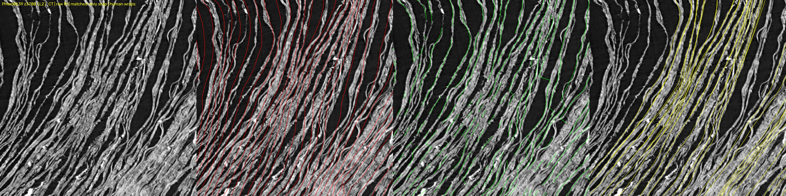
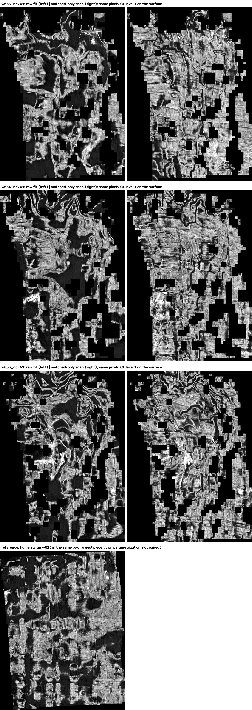

# consistent-snap: snap a whole spiral fit onto the sheet prediction without stacking wraps

Spiral fits (villa `fit_spiral`) give every winding of a scroll at once, but each winding floats a few voxels off the
papyrus. Snapping a single surface onto the surface prediction is easy. Snapping **all** windings is the hard case,
because two windings must not land on the same sheet. Paul (#unrolling-vc3d, 3 Nov 2026) called this
"trickier than it seems, and unsolved". This repo is a CPU-only tool for that case, tested against human ground truth
with bars fixed before scoring.

**Result in one line.** On PHerc0139 (volume 20260102150214) the snap keeps only nodes it could match one-to-one
("matched-only", Cm). It raises the share of human-wrap points within 2 voxels of a fitted surface from about 31 % to
about 53 %. Precision rises from about 28 % to 67 %. Both gains replicate on a second fit seed and on a second z band.
Stacking does not rise on two of the three fits; on band 2 it rises by 0.15 points, which fails that bar.



## How it works (`consistent_snap.py`)

The tool works per z slice (every 4th slice), on 2048 rays from the umbilicus:

1. **Find candidates.** Along each ray it finds where the fitted windings cross, in radial order, and where the
   predicted sheets are (runs of the recto prediction).
2. **Align.** An exact dynamic-programming alignment matches windings to sheets. Matches are one-to-one and keep
   the radial order. Moves are capped at 0.6 of the local winding spacing. Leaving a winding or a sheet unmatched has
   a cost.
3. **Smooth and realign.** The per-winding move field is median- and Gaussian-smoothed over (slice, ray). A second
   alignment then runs around the smoothed prior with a tighter cap (0.45 spacing).
4. **Move the nodes.** Nodes move radially. `snap_flag.tif` marks each node: 0 = matched one-to-one in pass 2,
   1 = moved by the smoothed field only, 3 = unmoved. `snap_d.tif` holds the move in voxels.
5. **Matched-only (Cm).** `tools/mask_flag.py <run> <out> 0` keeps flag 0 and turns the rest into holes. About 42 % of
   the fit's nodes survive. This is the arm that passes; the gap-filled nodes (flag 1) are where stacking comes back.

`--mode naive` runs the same pipeline with nearest-sheet-per-winding, the per-surface baseline. It needs no GPU:
a 1000-slice band with 115 windings runs in minutes on 8 CPU threads.

## Ground-truth test

**Truth.** The test uses the 36 public human wrap segments of PHerc0139 (w023-w059 without w046, with known defects
masked). No wrap was ever an input.

**Scorer.** The scorer is the November A/B scorer, unchanged (`vendor/score_band.py`, `vendor/score_band_b2.py`,
`vendor/score_ab.py`; copied from [fiber-strip-patches](https://github.com/TAUIL-Abd-Elilah/fiber-strip-patches)
and [spiral-patches-ab](https://github.com/TAUIL-Abd-Elilah/spiral-patches-ab)). It measures:
- within 2 and within 4 voxels: the share of wrap points that close to a fitted winding surface;
- adjacent-pair exactness: whether neighbouring wraps land on neighbouring windings;
- winding hops;
- per-wrap modal share: the share of a wrap's points on its most common winding;
- duplicate-sheet share.

**Precision.** `tools/precision.py` adds precision: among snapped nodes within 12 voxels of a wrap, the share within
2 voxels.

**Fits.** The raw fits are the arm-A fits of the November A/B: `novA1` and `novA2` (seeds 1 and 2, z 3200-4200) and
`b2A1` (z 4400-5400). Their configs are in fiber-strip-patches; the meshes are in this repo's release.

**Sheet evidence.** The public recto prediction
`20260102150214-surface-20260203205514-surface-recto-2um-ps192-L0-th0.5`, level 2 (the fit frame, 9.596 um).

**Bars.** The bars and parameters were written down before each score was seen, with UTC times, in
[`NOTES.md`](NOTES.md). The matched-only arm was added after the full snap failed the duplicate bar on a check that
did not use the human wraps. Its own bars were fixed before any human-wrap score of any snap arm existed. Because it
came second, it had to replicate on seed 2 and on band 2.

### Matched-only snap (Cm) against the raw fit (A)

| | seed 1 (z 3200-4200) | seed 2 (z 3200-4200) | band 2 (z 4400-5400) |
|---|---|---|---|
| within 2 vx, A → Cm | 31.3 → 52.2 % | 31.5 → 52.9 % | 30.6 → 53.4 % |
| B−A, 95 % CI (paired bootstrap over wraps) | +20.9 (+18.4 to +23.5) | +21.4 (+18.9 to +24.1) | +22.8 (+19.7 to +26.1) |
| within 4 vx | 60.4 → 72.8 % | 61.1 → 73.5 % | 60.3 → 74.8 % |
| precision (within 2 vx, nodes ≤ 12 vx from a wrap) | 28.9 → 67.4 % | 28.8 → 67.4 % | 27.7 → 67.1 % |
| adjacent-pair exact | 63.9 → 66.8 % | 64.0 → 66.9 % | 67.3 → 67.6 % |
| duplicate-sheet share (fit's own node spacing) | 3.6 → 3.2 % | 3.5 → 3.2 % | 2.29 → **2.44 %** |
| hop rate (hops per wrap point within 4 vx) | 0.0272 → 0.0206 | 0.0269 → 0.0205 | 0.0148 → **0.0206** |
| per-wrap modal share | 0.161 → 0.159 | 0.167 → 0.165 | 0.117 → 0.127 |

Bars, all fixed before the score:

| Bar | Result |
|---|---|
| within 2 not below A | passes on all three fits |
| precision at least A + 15 points | passes on all three fits |
| adjacent-pair exact at least A − 2 points | passes on all three fits |
| duplicate share not above A | passes on seeds 1 and 2; **fails on band 2 by 0.15 points** |

Hop rate and modal share were not bars for Cm. They are reported because they show the remaining weakness (below).

### The other pre-registered arms (seed 1)

| arm | within 2 vx | adjacent exact | winding hops (rate) | duplicate share (fit spacing) |
|---|---|---|---|---|
| A raw fit | 31.3 % | 63.9 % | 169,220 (0.027) | 3.6 % |
| N naive nearest-sheet snap | 63.2 % | 65.4 % | 1,102,441 (0.127) | 26.2 % |
| C full consistent snap (gap-filled) | 64.1 % | 67.1 % | 520,508 (0.059) | 18.2 % |
| Cm matched-only | 52.2 % | 66.8 % | 154,284 (0.021) | 3.2 % |

C was the pre-registered arm. It **failed** its duplicate bar: the duplicate share went from 3.6 % to 18.2 % at the
fit's own node spacing. Compared with the naive per-surface snap, the joint alignment halves the winding hops and cuts
stacking by a third at the same recall. That gain is not enough: both full snaps hop between windings more than the
raw fit, and the smoothed gap-fill puts unmatched windings onto
sheets that already have one. Cm drops those nodes and gives up about 12 points of recall for no added stacking.

**Check without the human wraps.** The mean CT intensity profile along surface normals has a peak-to-flank contrast
of −1.6 for the raw fit (flat: the fit sits off the sheet). The other values are +17.6 for C, +19.5 for N and
+21.6 for the human wraps themselves (`results/profile_box1.txt`). The snapped surfaces sit on the recto face.

## What the snap changes on the rendered surface

A surface helps reading only if the CT rendered on it shows papyrus. `tools/render_pair.py` renders the raw fit and
the matched-only snap on **the same pixels**. This works because Cm is the raw fit densified ×2, with each node moved
along its ray, so a grid index is the same fit position in both. Holes in Cm are masked in both arms. CT is level 1
(4.8 µm), sampled on the surface. The boxes are the published figure crops. Every winding with at least 300 snapped
nodes in a box is included. The rules were written in `NOTES.md` (v4) before any render was made.

| paired pixels, A → Cm | seed 1 (30 windings) | seed 2 (30) | band 2 (23) | human wraps, same box |
|---|---|---|---|---|
| mean CT on the surface | 78.3 → 96.3 | 78.5 → 96.7 | 70.6 → 94.9 | 86.3 / 78.5 |
| pixels above the box median | 59.7 → 82.5 % | 59.9 → 82.7 % | 55.2 → 85.2 % | 70.4 / 64.7 % |
| texture (std of Laplacian) | 11.6 → 14.5 | 11.9 → 14.9 | 10.5 → 13.8 | 12.6 / 12.5 |

- **Every winding improves.** On none of the 83 windings does the raw fit score as well as Cm on any of the three
  measures.
- **What the renders show.** The raw fit cuts through the dark gaps between sheets. The snap shows papyrus fibre
  texture over most of the same area, and the human-traced surface shows the same pattern.
- **The dark seams in Cm are the stair-steps** (see below).
- **Brighter is not better than the human traces.** Cm sits nearer the sheet's dense core, while the human traces
  sit nearer its face.
- **Ink is not tested here.**



Seed 2: `figures/render_seed2.jpg`; band 2: `figures/render_band2.jpg`. Numbers: `results/render_stats_*.json`.

## What is not solved

- **Stair-steps.** The fit drifts across sheets. Where it does, the snap moves a winding from one sheet to the next
  in a step, and a human wrap then switches fitted winding. The modal share does not improve, and on band 2 the hop
  rate gets worse. Step connectors are visible in the figures. Two tracking variants (a joint sweep and a
  quality-guided growth, `experiments/track_snap.py`) were worse on every check without the human wraps. They were
  dropped before scoring.
- **Holes.** Cm keeps about 42 % of the fit's nodes. The rest are holes, not wrong surface.
- **One scroll, one prediction, one fitter.** Tested only on PHerc0139, the recto prediction and villa
  `fit_spiral` fits.

### Tried and failed: winding labels over the sheet graph (`experiments/label_snap.py`, arm U)

The obvious fix for the steps is to give each predicted sheet one winding label, so that a winding cannot change
sheet between neighbouring rays. `label_snap.py` does this:
- it links sheet runs on neighbouring rays and slices;
- it joins them with union-find, carrying integer label offsets taken from the fit's winding id;
- it refuses links that break the radial order, or that join pieces whose offsets to the fit disagree;
- it gives each joined piece one offset to the fit, and moves winding w to the sheet labelled w.

Its parameters were set on one test slab, using only checks that do not involve the human wraps. Its bars were fixed
before any human-wrap score (`NOTES.md`, v3). **It fails them on all three fits.**

| U against A (raw fit) and Cm | seed 1 | seed 2 | band 2 | bar |
|---|---|---|---|---|
| hop rate (Cm) | 0.0109 (0.0206) | 0.0109 (0.0205) | 0.0123 (0.0206) | ≤ 0.75 × Cm: pass |
| duplicate share, fit spacing (A) | 1.19 % (3.6) | 1.16 % (3.5) | 1.08 % (2.29) | ≤ A: pass |
| per-wrap modal share (Cm) | 0.178 (0.159) | 0.178 (0.165) | 0.147 (0.127) | ≥ Cm + 0.03: **fail** |
| within 2 vx, gain over A | +13.8 | +14.97 | +15.1 | ≥ +15: **fail** on seeds 1 and 2 |
| adjacent-pair exact (A) | 58.0 % (63.9) | 59.3 % (64.0) | 57.3 % (67.3) | ≥ A − 2: **fail** |

What it shows:
- **The links hold.** Winding hops halve and stacking falls to about 1 %.
- **The offsets don't.** A joined piece often gets the wrong integer offset to the fit. The step then sits between
  two pieces instead of inside one winding: more neighbouring wraps share a winding (18 → 20-21 %), and fewer land
  on neighbouring windings (5-10 points down).

Fixing that needs offsets that are consistent between pieces, not one median offset per piece; this is not done.
Scores and logs: `results/*_U*`.

## Reproduce

Tested with Python 3.14, numpy 2.4, scipy, numba 0.66, opencv-python 5.0, tifffile, zarr 3.2 (CT reads in
`vendor/zfetch.py`).

```bash
# 1. mirror the recto prediction box (level 2) from the open-data bucket
python tools/mirror_chunks.py PHerc0139/representations/predictions/surfaces/20260102150214-surface-20260203205514-surface-recto-2um-ps192-L0-th0.5.zarr 2 data/p139_recto.zarr 3160 4240 1980 4790 1700 5140
python tools/mirror_chunks.py PHerc0139/representations/predictions/surfaces/20260102150214-surface-20260203205514-surface-recto-2um-ps192-L0-th0.5.zarr 2 data/p139_recto_b2.zarr 4360 5440 1880 4560 1660 5170
# 2. snap (fits and umbilicus: see the release and fiber-strip-patches/dataset*)
python consistent_snap.py --windings fitted_novA1 --surface data/p139_recto.zarr/2 --umbilicus umbilicus.json \
    --out runs/p139A1_consistent --z0 3200 --z1 4200 --densify 2 --bbox 1980 4790 1700 5140
python consistent_snap.py --windings fitted_b2A1 --surface data/p139_recto_b2.zarr/2 --umbilicus umbilicus_b2.json \
    --out runs/p139b2A1_consistent --z0 4400 --z1 5400 --densify 2 --bbox 1880 4560 1660 5170
# 3. matched-only arm, and the fit's own node spacing for the duplicate share
python tools/mask_flag.py runs/p139A1_consistent runs/p139A1_Cm 0
python tools/native_spacing.py runs/p139A1_Cm runs/p139A1_Cm_native 2
# 4. score (edit ROOT/SEGS at the top of vendor/score_band*.py to your wrap folder), compare, precision
python vendor/score_band.py --arm B=runs/p139A1_Cm --out results/score_Cm.json
python tools/compare_arms.py ab_seed1.json results/score_Cm.json      # ab_*.json: fiber-strip-patches/results
python tools/dup_native.py A=fitted_novA1 Cm=runs/p139A1_Cm_native
python tools/precision.py --segs segments_masked A=fitted_novA1 Cm=runs/p139A1_Cm
```

All other settings are the script defaults. Every run's arguments are in `results/report_*.json`.

## Files

- `consistent_snap.py`: the snapper.
- `tools/`: arm masks, scoring helpers, CT profiles, step and jump counts, figures, surface renders (`render_pair.py`), `label_diag.py`.
- `experiments/`: `track_snap.py` (two tracking variants) and `label_snap.py` (arm U); both failed and are kept as reported failures.
- `vendor/`: the unchanged scorers and the CT reader.
- `results/`: all score JSONs and logs behind the tables.
- `figures/`: CT cross-sections, each showing CT | raw fit | Cm | human wraps. Seed 1 at z 3400, 3700 and 4000;
  seed 2 at z 3700; band 2 at z 4900. The crop and slices were fixed by rule, not picked.
- [`NOTES.md`](NOTES.md): the time-stamped pre-registration and results log.
- **Release `v1`:** the three raw fits and the snapped meshes (C and Cm, at the fit's own node spacing) as tifxyz,
  ready for VC3D.

## License and credit

Code: MIT (`LICENSE`). Meshes, figures and results derive from Vesuvius Challenge open data and are CC BY-NC 4.0
(`LICENSE-DATA.md`). Thanks to the Vesuvius Challenge team for the scan, the human wrap segments, the umbilicus and
the surface predictions.

Written by TAUIL Abd Elilah with an AI assistant (Claude) doing much of the coding and analysis; all results were run
and checked on our own machine.
